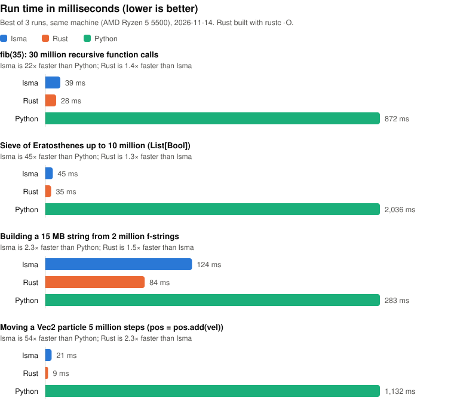

<p align="center">
  
</p>

<p align="center">
  
  
  
</p>

<p align="center">
  Tarn is a small programming language that reads like Python, checks like Kotlin<br>
  and compiles to native machine code through LLVM, the optimizer behind Rust.
</p>

<p align="center">
  <a href="#a-taste">A taste</a> &nbsp;·&nbsp;
  <a href="#quick-start">Quick start</a> &nbsp;·&nbsp;
  <a href="docs/language.md">Language guide</a> &nbsp;·&nbsp;
  <a href="#batteries">Standard library</a> &nbsp;·&nbsp;
  <a href="#editor-support">Editor</a> &nbsp;·&nbsp;
  <a href="#performance">Performance</a> &nbsp;·&nbsp;
  <a href="#how-it-works">How it works</a>
</p>

<br>

<a id="a-taste"></a>
## A taste

```python
import time

struct Task:
    name: String
    var done: Bool

    fn finish(self):
        self.done = true

fn main():
    val todo = [Task("write a compiler", false), Task("add a time module", false), Task("take a nap", false)]
    for task in todo:
        if task.name != "take a nap":
            task.finish()

    var finished = 0
    for task in todo:
        if task.done:
            finished += 1
    val today = time.now()
    print(f"{finished}/{todo.len()} done on {today.format("%A, %d %B %Y")}")
```

```console
$ tarn tasks.tr
2/3 done on Saturday, 14 November 2026
```

Run a script like Python, or build a standalone native binary:

<p align="center">
  
</p>

<a id="why-tarn"></a>
## Why Tarn

<table>
<tr>
<td width="33%" valign="top">

### Reads like Python

Indentation instead of braces. `for x in list`, `{"key": value}` maps, `x in xs`, `and` / `or` / `not`, f-strings. Run a file with `tarn app.tr`, just like `python app.py`, or give it a `#!/usr/bin/env tarn` line and run it directly.

</td>
<td width="33%" valign="top">

### Checks like Kotlin

`val` vs `var`. Null safety: only a `T?` can be `null`, and smart casts know when it isn't. Enums with data, and a `match` that must handle every case. Generics, with no bounds to write. No implicit conversions, no "truthy" values, and every path must `return`. Mistakes are caught before the program runs, with messages that tell you the fix.

</td>
<td width="33%" valign="top">

### Runs like Rust

Compiled ahead of time to a native binary with LLVM `-O3`. No garbage collector: memory is freed the moment it's no longer used. Integer overflow and out-of-bounds indexing still stop the program safely, and it ran **2–54× faster than Python** in the [benchmarks](#performance).

</td>
</tr>
</table>

<a id="errors"></a>
## Errors that teach

Tarn's checker is strict, but it explains itself: every error points at the exact spot and usually says how to fix it. Bugs that only show up at run time stop with a clear message and the line they came from:

<p align="center">
  
</p>

<a id="quick-start"></a>
## Quick start

You need [Rust](https://rustup.rs) to build the compiler, and `clang`, which Tarn uses to produce native code.

```bash
./install.sh             # default or custom install
tarn hello.tr            # run a script
tarn build app.tr -o app && ./app
```

<details>
<summary><b>See the installer</b>: default or custom installs, and an uninstaller that removes only what it put there</summary>
<br>
<p align="center">
  
</p>
</details>

| Command | |
|---|---|
| `tarn app.tr [args...]` | Compile and run. Unchanged scripts are cached and start in **~2 ms** |
| `tarn build app.tr -o app` | A standalone native binary that runs without Tarn |
| `tarn check app.tr` | Type-check and lint only |
| `tarn build app.tr --emit-llvm` | Also write the generated LLVM IR |
| `tarn build app.tr --emit-mir` | Also write the mid-level IR, with every reference-count operation |
| `tarn run --arc-stats app.tr` | Print allocations, frees and peak memory when the program exits |
| `tarn run --debug app.tr` | Build without optimizations (`-O0 -g`) |
| `./uninstall.sh` | Remove what the installer put there (everything, or pick) |

Installation details, options and the uninstaller are covered in [docs/install.md](docs/install.md).

<a id="language"></a>
## The language in one screen

```python
import time                                  # the standard library is written in Tarn

struct Point:                                # structs with typed fields
    var x: Float                             # fields are immutable unless `var`
    var y: Float

    fn length(self) -> Float:                # methods take `self`
        return sqrt(self.x * self.x + self.y * self.y)

    fn +(self, other: Point) -> Point:       # operator functions: `p + q`
        return Point(self.x + other.x, self.y + other.y)

fn clamp[T](x: T, low: T, high: T) -> T:     # generics: any `T` that has `<` and `>`
    if x < low:
        return low
    elif x > high:
        return high
    return x

enum Shape:                                  # enums whose variants carry data
    Circle(radius: Float)
    Rect(w: Float, h: Float)

fn area(s: Shape) -> Float:
    match s:                                 # the compiler checks every case is handled
        case Circle(r):
            return 3.14159 * r * r
        case Rect(w, h):
            return w * h

fn first_long(words: List[String]) -> String?:  # `String?`: a String or null
    for w in words:
        if w.len() > 3:
            return w
    return null

fn main():
    val p = Point(x=3.0, y=4.0)              # `val` can't be reassigned...
    var count = 0                            # ...`var` can
    val xs: List[Int] = [5, 3, 8]            # lists are typed and bounds-checked
    xs.push(clamp(42, 0, 10))
    for x in xs:                             # loop over a list...
        count += x
    for i in 0..3:                           # ...or a range
        print(f"{i}: {xs[i]}")               # f-strings
    print(xs.filter(fn(x) -> x > 4).map(fn(x) -> x * 2))  # lambdas, inlined into the loops: [10, 16, 20]
    val stock = {"apple": 3, "fig": 0}       # maps (Map[String, Int]), in insertion order
    stock["pear"] = stock.get("pear", 0) + 5
    for fruit, n in stock:
        if n > 0 and fruit not in ["fig"]:
            print(f"{fruit}: {n}")
    print(stock)                             # {"apple": 3, "fig": 0, "pear": 5}
    print(f"|p + p| = {(p + p).length()}, sum = {count}")
    val word = first_long(["a", "tiny", "list"])
    print(word?.len() ?: 0)                  # safe call `?.` and elvis `?:`
    if word != null:
        print(word.len())                    # smart cast: `word` is a String here
    print(area(Shape.Rect(w=2.0, h=3.0)))
    print(time.now().to_iso())
```

Bigger programs split into files. Every `.tr` file is a module:

```python
# geometry.tr
struct Point:
    x: Float
    y: Float

fn _square(x: Float) -> Float:               # `_names` are private to their module
    return x * x

fn dist(a: Point, b: Point) -> Float:
    return sqrt(_square(a.x - b.x) + _square(a.y - b.y))
```

```python
# main.tr
from geometry import Point, dist             # or `import geometry`, then `geometry.dist(...)`

fn main():
    print(dist(Point(0.0, 0.0), Point(3.0, 4.0)))
```

The [**language guide**](docs/language.md) covers everything: types, constants, strictness rules, lints, functions and lambdas, structs, enums and `match`, operator functions, generics, lists, maps, strings, null safety, modules, built-ins and panics.

<a id="batteries"></a>
## Batteries included

The standard library is written in Tarn itself and compiled together with your program:

| Module | |
|---|---|
| [`time`](docs/time.md) | UTC dates and times, durations, clocks. Cross-checked against Python's `datetime` on 3,000 random dates |
| [`math`](docs/math.md) | `pi`, `e`, `inf`; powers and logarithms; trigonometry; rounding; generic `min`, `max`, `clamp`, `abs`; `gcd`, `lcm`, `isqrt` |
| [`fs`](docs/fs.md) | Read and write files, list and create folders, and take paths apart |

```python
import fs
import math
import time

fn main():
    val hits: Map[String, Int] = {}                  # page -> number of requests
    for line in fs.read_lines("access.log"):
        val page = line.split()[6]
        hits[page] = hits.get(page, 0) + 1
    var total = 0
    for _, n in hits:
        total += n
    for page, n in hits:                             # in the order pages first appeared
        val pct = math.round(100.0 * n.to_float() / total.to_float())
        print(f"{page.pad_end(24)} {n.to_string().pad_start(6)}  {pct}%")

    val landing = time.parse_iso("1969-07-20T20:17:40Z")
    print(f"Moon landing was a {landing.weekday_name()}")
    print(f"{((time.now() - landing) / time.days(365)).to_int()} years ago")   # DateTime - DateTime is a Duration
```

<p align="center">
  
</p>

<a id="editor-support"></a>
## Editor support


The VS Code extension (in the companion `tarn-vscode` project) gets all its smarts from **`tarn lsp`**, a language server built into the compiler. So the editor always agrees with `tarn build`. It provides:

- **Live type checking and lints** as you type. Unused and unreachable code is faded out.
- **Hover** shows the type of any variable or expression, including inferred types and smart casts, plus `#` doc comments.
- **Inlay type hints**: `val total = price * qty` shows as `val total: Float = …`.
- **Completion** for members after `.` and `?.`, module functions and constants after `math.`, files and folders after `import` and `from`, a module's names after `from geometry import`, and variables in scope. Completing after `.` on a value that might be null turns it into `?.`.
- **Multi-file aware.** Go to definition jumps into your other files. Editing a module re-checks the open files that import it, even before you save, and an error inside an imported file shows on the `import` line that leads to it.
- **Go to definition**, an **outline view**, syntax highlighting, snippets and a **Run** button.
- **Automatic restarts**: when you reinstall `tarn`, the extension notices and restarts the language server by itself.
- **Tarn Light** and **Tarn Dark**, color themes in the same quiet style as this page: hairline borders and a few muted colors, on white or near-black.

<a id="performance"></a>
## Performance

<p align="center">
  
</p>

| Benchmark | Tarn | Rust (`rustc -O`) | Python 3 |
|---|---:|---:|---:|
| `fib(35)`: 30 million recursive calls | 38 ms | 28 ms | 872 ms |
| Sieve of Eratosthenes to 10 million | 49 ms | 41 ms | 2,012 ms |
| Building a 15 MB string from 2 million f-strings | 120 ms | 83 ms | 278 ms |
| Moving a `Vec2` particle 5 million steps (`pos = pos + vel`) | 21 ms | 9 ms | 1,129 ms |
| Binary trees: building and walking 3 million `enum` nodes | 41 ms | 92 ms | 319 ms |
| Hash maps: 4 million counting updates (`m[k] = m.get(k, 0) + 1`), `Int` and `String` keys | 375 ms | 277 ms | 1,557 ms |

These are the best of 3 runs on an AMD Ryzen 5 5500. Reproduce them with `./bench/run.sh`.

- **Where the gap to Rust comes from.** Most of it is safety: Tarn checks every integer operation for overflow, while Rust in release mode silently wraps. With the same checks (`rustc -O -C overflow-checks=on`), Rust's `fib` takes about 46 ms, slower than Tarn.
- **Help for the optimizer.** Tarn tells LLVM which memory can never overlap (TBAA metadata). That lets list lengths stay in CPU registers inside hot loops.
- **Memory without a garbage collector.** Values are reference counted, and the compiler removes most of the counting (see [Memory](docs/language.md#memory)). The particle loop allocates 3 objects in total, because each new `Vec2` reuses the memory of the one it replaces. Peak memory stayed within 10% of Rust's on the string, particle and tree benchmarks.
- **Why Tarn beats Rust on binary trees.** Both programs allocate one heap node per tree node (`Leaf` costs nothing: it's a shared constant in Tarn, and `None` in Rust). Tarn recycles freed nodes through its own size-class free lists, while Rust here uses the system `malloc`. Walking the tree does no reference counting at all, because the match borrows the fields.
- **Maps keep insertion order, which costs a little.** Tarn's `Map` is laid out like Python's `dict` (and Rust's `IndexMap`): entries in an array, in order, found through an index. A lookup reads the index and then the entry, one after the other, while Rust's unordered `HashMap` can fetch both at once. With the keys in cache, Tarn and Rust are about as fast; with half a million keys, memory waits make the difference. In return, loops, `keys()` and printing are always in a predictable order.
- **Benchmarking your own code.** LLVM deletes loops whose results are never used, so print what you compute or you'll measure `0 ms`. `tarn run --debug` turns optimization off.

<a id="how-it-works"></a>
## How it works

<p align="center">
  
</p>

- **One front end, two uses.** The same lexer, parser and type checker compile your programs and power the editor through `tarn lsp`.
- **Every file is a namespace of one type checker.** [`src/project.rs`](src/project.rs) finds each `import` relative to the file that contains it and loads every file once, so modules may import each other. All files share one offset space for source positions, which is how errors, panic locations and go-to-definition land in the right file. The whole program becomes one LLVM module, so calls across files inline like any others.
- **The standard library is Tarn code** ([`stdlib/`](stdlib)), compiled together with your program, so it's as fast as your own functions. A panic inside it reports *your* calling line, like Rust's `#[track_caller]`.
- **Memory management happens on a mid-level IR.** The typed program is lowered to a control-flow graph in which every intermediate value has a name ([`src/mir.rs`](src/mir.rs)). [`src/arc.rs`](src/arc.rs) then adds reference counting in the style of Perceus (Koka, Lean 4). It drops each value right after its last use. Parameters are borrowed unless consumed, and projections stay borrowed while interprocedural write-effect summaries prove their slot can't change. A unique struct's memory is reused for the next one, and unique strings are appended to in place. Types that can form cycles get a trial-deletion cycle collector. [`src/cycles.rs`](src/cycles.rs) decides which, from the type graph: a cycle needs a reference that can be replaced after construction, so immutable trees never pay for it.
- **Operators on your types are method calls.** `a + b` on a struct type-checks to a direct call of its `fn +`, picked by the right operand's type when there are several, and `a < b` to `fn <=>`. The optimizer and the reference counting see an ordinary call: `acc = acc + v` reuses `acc`'s memory, and the particle benchmark runs as fast as with `pos.add(vel)`.
- **Generics are checked once and compiled per use.** A generic function is type-checked a single time with `T` left abstract ([`src/check/generics.rs`](src/check/generics.rs)). What the code does with a `T` (compare it, add it, print it) becomes what `T` must support, passed along through calls between generic functions and settled for recursion as a fixed point. Each use with concrete types is checked against that list. Then the body is checked again for every set of types it's used with, producing ordinary functions and structs (`max[Int]`, `Box[String]`). Nothing generic reaches the back end, so generic code is exactly as fast as code written out by hand, and reference counting and memory reuse work on it unchanged.
- **`match` is checked with Maranget's usefulness algorithm** ([`src/patterns.rs`](src/patterns.rs)), as in Rust and OCaml. The same pass that proves a `match` exhaustive produces the missing cases for the error message and finds unreachable ones. Cases compile to chains of tag tests, which LLVM merges into a `switch`. Enums without data are plain integers, and data-less variants of other enums are shared constants.
- **Maps are hash tables in the runtime, entries laid out by the compiler.** Each `Map[K, V]` type gets a small type record (the entry's size, how to hash and compare its keys) and its keys and values live inline in the entries: no boxing. `Int` and `String` keys are hashed and compared by the runtime itself; a struct key goes through generated functions that call its `fn hash` and `fn ==`. Reference counting stays in generated code, as for lists, and a map that can hold itself joins the cycle collector.
- **Top-level `val`s are evaluated by the checker** ([`src/check/consts.rs`](src/check/consts.rs)), with overflow checks and cycle detection, and every use becomes a literal.
- **Codegen writes LLVM IR as text** and hands it to `clang -O3`, together with a ~1,500-line C runtime: the allocator, the cycle collector, strings, lists, hash maps, printing, files and clocks.
- **Null safety is checked by flow typing.** The checker tracks which locals and `val` field chains are known to be non-null at each point (through `if`, `and`/`or`, loops, early `return`s and `?:`), which is what makes smart casts work. At run time it costs nothing: `User?` is a nullable pointer, and `Int?` is a flag-plus-value pair that stays in registers.
- **Safety stays cheap.**
  - Integer `+ - *` use LLVM's overflow-checking intrinsics.
  - Panic paths are marked cold.
  - List indexing is bounds-checked inline.
- **About 18,000 lines of Rust.** The only dependencies are `ariadne` (error rendering) and `lsp-server` / `lsp-types` (the language server).

<a id="roadmap"></a>
## Roadmap

- [x] Core language: `val`/`var`, functions, structs, lists, f-strings, strict types
- [x] Native compilation through LLVM, with overflow and bounds checks
- [x] Lints, error hints and a VS Code extension with a language server
- [x] `import` and a standard library written in Tarn (`time`)
- [x] Null safety: `Int?`, `?.`, the elvis operator `?:`, `!!`, smart casts
- [x] Memory management through automatic reference counting, with a cycle collector
- [x] `enum` + `match` with exhaustiveness checking
- [x] Importing your own `.tr` files: `import`, `from ... import`, `as`, folders and `..`
- [x] Operator functions: `fn +(self, other: T)`, `==`, `<=>`, `[]`, so `time.now() - start` is a `Duration`
- [x] Generics for user code: `fn max[T](a: T, b: T) -> T`, `struct Box[T]`, `enum Tree[T]`
- [x] `Map[K, V]` with `{k: v}` literals, `in`, constants (`val pi = ...`), the `math` and `fs` modules, and string and list utilities (`split`, `join`, `trim`, `replace`, `sort`...)
- [x] First-class functions and lambdas: `xs.map(fn(x) -> x * 2)`, `sort_by`, closures, function types
- [ ] Interfaces, so generic code can call methods on a `T`
- [ ] Tuples and sets

<a id="development"></a>
## Development

```bash
cargo test                          # unit tests + every program in tests/ (also leak-checked and run under ASan)
./bench/run.sh                      # Tarn vs Rust vs Python (writes bench/results.json)
python3 docs/media/generate.py      # re-render the README's media from real runs
```

<details>
<summary><b>Project layout</b></summary>

```
src/            compiler: lexer, parser, checker, codegen, driver, language server, CLI
stdlib/         the standard library, written in Tarn (time, math, fs)
runtime/        the small C runtime linked into every program
examples/       hello, fib, fizzbuzz, structs, primes_sieve, sort, collatz, guess, calc, clock, wordfreq
tests/run/      programs + their expected output
tests/fail/     programs that must not compile    (# expect-error: ...)
tests/warn/     programs that must warn            (# expect-warning: ...)
tests/panic/    programs that must panic           (# expect-panic: ...)
tests/arc/      programs with an allocation budget (# expect-max-allocs: ...)
bench/          Tarn vs Rust vs Python
docs/           language guide, time / math / fs references, install guide, README media
install.sh      the installer (default or custom)
uninstall.sh    the uninstaller (everything, or pick)
```
</details>

<br>

<p align="center">
  <br>
  <sub>Made for fun. The terminal recordings are real runs of Tarn, and the chart uses real benchmark results.<br>Every image here is drawn by <code>docs/media/generate.py</code>.</sub>
</p>
