<p align="center">
  
</p>

<p align="center">
  
  
  
  
  
</p>

<p align="center">
  <b>Isma</b> is a small programming language that <b>reads like Python</b>, <b>checks like Kotlin</b><br>
  and <b>compiles to native machine code</b> through LLVM, the optimizer behind Rust.
</p>

<p align="center">
  <a href="#a-taste">A taste</a> ·
  <a href="#quick-start">Quick start</a> ·
  <a href="docs/language.md">Language guide</a> ·
  <a href="docs/time.md"><code>time</code> module</a> ·
  <a href="#editor-support">VS Code</a> ·
  <a href="#performance">Performance</a> ·
  <a href="#how-it-works">How it works</a>
</p>

<br>

<a id="a-taste"></a>
## 🌱 A taste

```python
import time

struct Task:
    name: String
    var done: Bool

    fn finish(self):
        self.done = true

fn main():
    val todo = [Task("write a compiler", false), Task("add a time module", false), Task("take a nap", false)]
    for task in todo:
        if task.name != "take a nap":
            task.finish()

    var finished = 0
    for task in todo:
        if task.done:
            finished += 1
    val today = time.now()
    print(f"{finished}/{todo.len()} done on {today.format("%A, %d %B %Y")}")
```

```console
$ isma tasks.isma
2/3 done on Saturday, 14 November 2026
```

Run a script like Python, or build a standalone native binary:

<p align="center">
  
</p>

<a id="why-isma"></a>
## 💡 Why Isma?

<table>
<tr>
<td width="33%" valign="top">

### 🐍 Reads like Python

Indentation instead of braces. `for x in list`, `and` / `or` / `not`, f-strings. Run a file with `isma app.isma`, just like `python app.py`, or give it a `#!/usr/bin/env isma` line and run it directly.

</td>
<td width="33%" valign="top">

### 🛡️ Checks like Kotlin

`val` vs `var`. No `null`, no implicit conversions, no "truthy" values, and every path must `return`. Mistakes are caught before the program runs, with messages that tell you the fix.

</td>
<td width="33%" valign="top">

### ⚡ Runs like Rust

Compiled ahead of time to a native binary with LLVM `-O3`. No garbage collector: memory is freed the moment it's no longer used. Integer overflow and out-of-bounds indexing still stop the program safely, and it ran **2–54× faster than Python** in the [benchmarks](#performance).

</td>
</tr>
</table>

<a id="errors"></a>
## 🧑‍🏫 Errors that teach

Isma's checker is strict, but it explains itself: every error points at the exact spot and usually says how to fix it. Bugs that only show up at run time stop with a clear message and the line they came from:

<p align="center">
  
</p>

<a id="quick-start"></a>
## 🚀 Quick start

You need [Rust](https://rustup.rs) to build the compiler, and `clang`, which Isma uses to produce native code.

```bash
./install.sh             # pick [1] default or [2] custom
isma hello.isma          # run a script
isma build app.isma -o app && ./app
```

<details>
<summary><b>📺 Watch the installer</b>: a hacker-styled installer with default and custom modes, plus a matching uninstaller</summary>
<br>
<p align="center">
  
</p>
</details>

| Command | |
|---|---|
| `isma app.isma [args...]` | Compile and run. Unchanged scripts are cached and start in **~2 ms** |
| `isma build app.isma -o app` | A standalone native binary that runs without Isma |
| `isma check app.isma` | Type-check and lint only |
| `isma build app.isma --emit-llvm` | Also write the generated LLVM IR |
| `isma build app.isma --emit-mir` | Also write the mid-level IR, with every reference-count operation |
| `isma run --arc-stats app.isma` | Print allocations, frees and peak memory when the program exits |
| `isma run --debug app.isma` | Build without optimizations (`-O0 -g`) |
| `./uninstall.sh` | Remove everything Isma installed (default or pick targets) |

Installation details, options and the uninstaller are covered in [docs/install.md](docs/install.md).

<a id="language"></a>
## 📖 The language in one screen

```python
import time                                  # the standard library is written in Isma

struct Point:                                # structs with typed fields
    var x: Float                             # fields are immutable unless `var`
    var y: Float

    fn length(self) -> Float:                # methods take `self`
        return sqrt(self.x * self.x + self.y * self.y)

fn clamp(x: Int, low: Int, high: Int) -> Int:
    if x < low:
        return low
    elif x > high:
        return high
    return x

fn main():
    val p = Point(x=3.0, y=4.0)              # `val` can't be reassigned...
    var count = 0                            # ...`var` can
    val xs: List[Int] = [5, 3, 8]            # lists are typed and bounds-checked
    xs.push(clamp(42, 0, 10))
    for x in xs:                             # loop over a list...
        count += x
    for i in 0..3:                           # ...or a range
        print(f"{i}: {xs[i]}")               # f-strings
    print(f"|p| = {p.length()}, sum = {count}")
    print(time.now().to_iso())
```

The [**language guide**](docs/language.md) covers everything: types, strictness rules, lints, structs, lists, strings, modules, built-ins and panics.

<a id="time"></a>
## 🕰️ Batteries included: `time`

The first standard-library module handles UTC dates, times and clocks, and it's written in Isma itself. It was cross-checked against Python's `datetime` on 3,000 random dates.

```python
import time

fn main():
    val now = time.now()
    print(now.format("%A, %d %B %Y at %H:%M"))
    val landing = time.parse_iso("1969-07-20T20:17:40Z")
    print(f"Moon landing was a {landing.weekday_name()}")
    print(f"{now.seconds_since(landing) / (365 * 86400)} years ago")
```

<p align="center">
  
</p>

Every function, format code and helper is listed in the [`time` reference](docs/time.md).

<a id="editor-support"></a>
## 🧩 Editor support


The VS Code extension (in the companion `isma-vscode` project) gets all its smarts from **`isma lsp`**, a language server built into the compiler. So the editor always agrees with `isma build`. It provides:

- **Live type checking and lints** as you type. Unused and unreachable code is faded out.
- **Hover** shows the type of any variable or expression, including inferred types, plus `#` doc comments.
- **Inlay type hints**: `val total = price * qty` shows as `val total: Float = …`.
- **Completion** for members after `.`, module functions after `time.`, modules after `import `, and variables in scope.
- **Go to definition**, an **outline view**, syntax highlighting, snippets and a **▶ Run** button.
- **Automatic restarts**: when you reinstall `isma`, the extension notices and restarts the language server by itself.

<a id="performance"></a>
## ⚡ Performance

<p align="center">
  
</p>

| Benchmark | Isma | Rust (`rustc -O`) | Python 3 |
|---|---:|---:|---:|
| `fib(35)`: 30 million recursive calls | 39 ms | 28 ms | 872 ms |
| Sieve of Eratosthenes to 10 million | 45 ms | 35 ms | 2,036 ms |
| Building a 15 MB string from 2 million f-strings | 124 ms | 84 ms | 283 ms |
| Moving a `Vec2` particle 5 million steps (`pos = pos.add(vel)`) | 21 ms | 9 ms | 1,132 ms |

These are the best of 3 runs on an AMD Ryzen 5 5500. Reproduce them with `./bench/run.sh`.

- **Where the gap to Rust comes from.** Most of it is safety: Isma checks every integer operation for overflow, while Rust in release mode silently wraps. With the same checks (`rustc -O -C overflow-checks=on`), Rust's `fib` takes about 46 ms, slower than Isma.
- **Help for the optimizer.** Isma tells LLVM which memory can never overlap (TBAA metadata). That lets list lengths stay in CPU registers inside hot loops.
- **Memory without a garbage collector.** Values are reference counted, and the compiler removes most of the counting (see [Memory](docs/language.md#memory)). The particle loop allocates 3 objects in total, because each new `Vec2` reuses the memory of the one it replaces. Peak memory stayed within 10% of Rust's on both new benchmarks.
- **Benchmarking your own code.** LLVM deletes loops whose results are never used, so print what you compute or you'll measure `0 ms`. `isma run --debug` turns optimization off.

<a id="how-it-works"></a>
## 🔧 How it works

<p align="center">
  
</p>

- **One front end, two uses.** The same lexer, parser and type checker compile your programs and power the editor through `isma lsp`.
- **The standard library is Isma code** ([`stdlib/time.isma`](stdlib/time.isma)), compiled together with your program, so it's as fast as your own functions. A panic inside it reports *your* calling line, like Rust's `#[track_caller]`.
- **Memory management happens on a mid-level IR.** The typed program is lowered to a control-flow graph in which every intermediate value has a name ([`src/mir.rs`](src/mir.rs)). [`src/arc.rs`](src/arc.rs) then adds reference counting in the style of Perceus (Koka, Lean 4). It drops each value right after its last use. Parameters are borrowed unless consumed, and projections stay borrowed while interprocedural write-effect summaries prove their slot can't change. A unique struct's memory is reused for the next one, and unique strings are appended to in place. Types that can form cycles ([`src/cycles.rs`](src/cycles.rs)) get a trial-deletion cycle collector.
- **Codegen writes LLVM IR as text** and hands it to `clang -O3`, together with a ~750-line C runtime: the allocator, the cycle collector, strings, lists, printing and clocks.
- **Safety stays cheap.**
  - Integer `+ - *` use LLVM's overflow-checking intrinsics.
  - Panic paths are marked cold.
  - List indexing is bounds-checked inline.
- **About 8,800 lines of Rust.** The only dependencies are `ariadne` (error rendering) and `lsp-server` / `lsp-types` (the language server).

<a id="roadmap"></a>
## 🗺️ Roadmap

- [x] Core language: `val`/`var`, functions, structs, lists, f-strings, strict types
- [x] Native compilation through LLVM, with overflow and bounds checks
- [x] Lints, error hints and a VS Code extension with a language server
- [x] `import` and a standard library written in Isma (`time`)
- [ ] Null safety: `Int?`, `?.`, the elvis operator `?:`, smart casts
- [x] Memory management through automatic reference counting, with a cycle collector
- [ ] `enum` + `match` with exhaustiveness checking
- [ ] Generics for user code: `fn max[T](a: T, b: T) -> T`
- [ ] Operator functions (so that `time.now() - start` works)
- [ ] Importing your own `.isma` files
- [ ] More modules: `math`, `fs`, maps, more string utilities

<a id="development"></a>
## 🧪 Development

```bash
cargo test                          # unit tests + every program in tests/ (also leak-checked and run under ASan)
./bench/run.sh                      # Isma vs Rust vs Python (writes bench/results.json)
python3 docs/media/generate.py      # re-render the README's media from real runs
```

<details>
<summary><b>Project layout</b></summary>

```
src/            compiler: lexer, parser, checker, codegen, driver, language server, CLI
stdlib/         the standard library, written in Isma (time.isma)
runtime/        the small C runtime linked into every program
examples/       hello, fib, fizzbuzz, structs, primes_sieve, sort, collatz, guess, calc, clock
tests/run/      programs + their expected output
tests/fail/     programs that must not compile    (# expect-error: ...)
tests/warn/     programs that must warn            (# expect-warning: ...)
tests/panic/    programs that must panic           (# expect-panic: ...)
tests/arc/      programs with an allocation budget (# expect-max-allocs: ...)
bench/          Isma vs Rust vs Python
docs/           language guide, time reference, install guide, README media
install.sh      the installer (default or custom)
uninstall.sh    the uninstaller (wipe all or pick targets)
```
</details>

<br>

<p align="center"><sub>Made for fun. The terminal recordings above are real runs of Isma and the chart uses real benchmark results. All images are generated by <code>docs/media/generate.py</code>.</sub></p>
